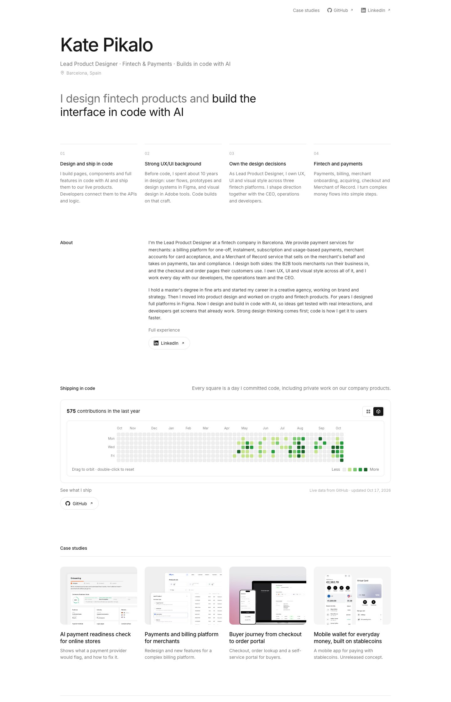

# Kate Pikalo — Portfolio

Lead Product Designer in fintech and payments. I design products and build the interface in code with AI.

**Live site: [pikalokate.github.io](https://pikalokate.github.io)**

[](https://pikalokate.github.io)

## Case studies

- [AI payment readiness check for online stores](https://pikalokate.github.io/projects/onbold-ai/)
- [Payments and billing platform for merchants](https://pikalokate.github.io/projects/billpro/)
- [Buyer journey from checkout to order portal](https://pikalokate.github.io/projects/buyer-journey/)
- [Mobile wallet for everyday money, built on stablecoins](https://pikalokate.github.io/projects/lytro/)

## How it's built

- Next.js (static export), React, Tailwind CSS and TypeScript
- The contribution calendar shows my real GitHub activity. A GitHub Action refreshes it every 6 hours and redeploys the site.
- Hosted on GitHub Pages

```bash
npm install
npm run dev        # http://localhost:3000
npm run build      # static site in out/
```

Screenshots and videos in the case studies use demo data.
